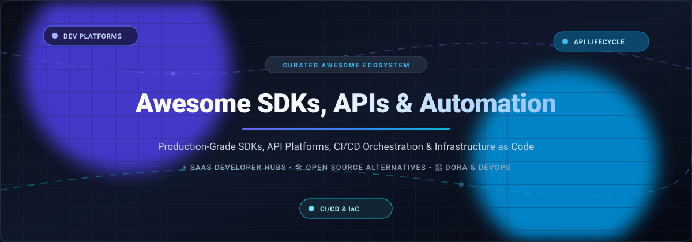

  

# 🚀 Awesome SDKs, APIs & Automation Tooling

  
  
  
  
  
  
  

> 🛠️ A curated directory of top **SDKs, APIs, and Automation Tooling platforms** — featuring commercial SaaS developer platforms and battle-tested open-source alternatives for building, testing, deploying, and automating software delivery and cloud infrastructure.

🌟 **Star this repository if you find it helpful!** 🌟

---

## 📋 Table of Contents

- [🌐 Sector Overview & Market Dynamics](#-sector-overview--market-dynamics)
- [🟦 SaaS / Hosted Platforms](#-saas--hosted-platforms)
  - [📊 Commercial SaaS Comparison Matrix](#-commercial-saas-comparison-matrix)
  - [🔍 SaaS Platform Deep Dives](#-saas-platform-deep-dives)
- [🟩 Open-Source Software](#-open-source-software)
  - [⭐ Open-Source Solutions by Stars_Count](#-open-source-solutions-by-star-count)
  - [🔬 Open-Source Project Deep Dives](#-open-source-project-deep-dives)
- [⚖️ Comparison at a Glance](#-comparison-at-a-glance)
- [📈 Star History](#-star-history)
- [💖 Support & Sponsorship](#-support--sponsorship)
- [🤝 Contributing](#-contributing)
- [📄 License](#-license)

---

## 🌐 Sector Overview & Market Dynamics

The global developer tools, API management, and DevOps automation market is estimated at **$28B–$35B+ in 2025–2026** (projected to exceed $55B+ by 2030 at ~18%–22% CAGR), driven by cloud-native engineering, microservices, API-first architectures, and AI-accelerated development lifecycles.

Market dynamics reflect a **moderately fragmented yet oligopolistic ecosystem**: hyper-scale cloud providers (Microsoft/GitHub, Amazon AWS) dominate source control, cloud infrastructure, and enterprise deployment, while highly focused best-of-breed platforms (Postman in API lifecycles, GitLab in unified DevSecOps, and CircleCI in high-concurrency CI/CD) capture strong multi-billion-dollar enterprise market share alongside a thriving, community-led open-source movement.

---

## 🟦 SaaS / Hosted Platforms

Commercial, cloud-hosted SDK, API, and automation tooling platforms sorted in descending order by enterprise valuation and scale.

### 📊 Commercial SaaS Comparison Matrix

| Platform | Company Valuation / Revenue | Starting Tier Pricing | Free Tier / Trial Limits | Key Capabilities |
| :--- | :--- | :--- | :--- | :--- |
| **[Microsoft Azure DevOps](https://azure.microsoft.com/en-us/products/devops/)** | 🏢 **$3.1T+ Market Cap** *(Microsoft parent; ~$110B+ Intelligent Cloud)* | 💰 **$6 / user / month** *(Basic Plan)*; Pipelines at **$40 / month** per parallel job | 🎁 **Free for up to 5 users** forever; Includes Azure Pipelines with 1,800 free build minutes/month & 1 free hosted parallel job, unlimited private Git repos, and Boards | Enterprise Git hosting, automated CI/CD pipelines, Agile Kanban boards, artifact feeds, and deep Microsoft cloud integration. |
| **[Amazon AWS Developer Tools](https://aws.amazon.com/developer/tools/)** | 🏢 **$2.2T+ Market Cap** *(Amazon parent; ~$105B+ AWS annual revenue)* | 💰 **$1 / user / month** for CodeCommit (active users); CodeBuild from **$0.005 / build minute** *(general1.small)* | 🎁 **Free Forever Tier**: CodeBuild includes 100 build minutes/month (`build.general1.small`), CodePipeline provides 1 free active pipeline/month, CodeCommit includes 5 free active users forever | Deep AWS native integration, managed CI/CD build environments, zero-server deployment orchestration, and IAM governance. |
| **[GitHub Developer Platform](https://github.com/)** | 🏢 **$100B+ Estimated Enterprise Value** *(Microsoft-owned; ~$1B+ ARR)* | 💰 **$4 / user / month** *(Team plan, billed annually)* | 🎁 **Free Forever Plan**: Unlimited public/private repositories, 2,000 GitHub Actions CI/CD minutes/month for private repos (unlimited for public repos), and 500 MB GitHub Packages storage | World's leading code repository ecosystem, GitHub Actions automation, GitHub Apps API marketplace, and Copilot AI developer tools. |
| **[GitLab Developer Platform](https://about.gitlab.com/)** | 🏢 **$9B – $11B Market Cap** *(NASDAQ: GTLB; ~$700M+ Annual Revenue)* | 💰 **$29 / user / month** *(Premium tier, billed annually)* | 🎁 **Free Forever Plan**: 1 namespace, up to 5 users per namespace, 400 compute compute credits/month for GitLab CI/CD pipelines, and 5 GB storage | Unified single-application DevSecOps platform, built-in CI/CD pipelines, container registry, and container vulnerability scanning. |
| **[Postman](https://www.postman.com/)** | 🏢 **$5.6B Valuation** *(Last private financing round)* | 💰 **$14 / user / month** *(Basic plan, billed annually)* or $19 billed monthly | 🎁 **Free Forever Plan**: Up to 3 team members, unlimited API requests, 10,000 Postman API calls/month, and 1,000 mock server / collection run calls | Complete API lifecycle workspace, collaborative request collections, automated Newman CLI test runs, mock servers, and API monitors. |
| **[Druva Developer Portal](https://developer.druva.com/)** | 🏢 **$2B+ Valuation** *(Late-stage unicorn; $250M+ ARR)* | 💰 **$2.50 / user / month** *(Druva inSync starting tier, annual commitment)* | 🔒 **30-Day Free Trial** with full enterprise API access, sandbox environment for script validation, and pre-configured webhooks | Cloud-native data protection REST APIs, event-driven webhooks, enterprise automation sandbox, and ecosystem marketplace apps. |
| **[CircleCI](https://circleci.com/)** | 🏢 **$1.7B Valuation** *(Last private financing round)* | 💰 **$15 / month** *(Scale tier includes 3 active users and 30,000 credits)* | 🎁 **Free Forever Plan**: Up to 6,000 build minutes (30,000 credits) per month, max 30 concurrent jobs, and unlimited users on free tier | High-performance cloud CI/CD, advanced Docker layer caching, parallel build test splitting, and reusable configuration Orbs. |

---

### 🔍 SaaS Platform Deep Dives

#### 1. [Azure DevOps](https://azure.microsoft.com/en-us/products/devops/)
- **Category:** Enterprise DevOps & Delivery Suite | **Deployment:** Cloud / Self-Hosted Server
- **Pricing:** Starts at **$6/user/month** for Basic plan; additional parallel CI/CD pipelines cost **$40/month** (cloud-hosted) or **$15/month** (self-hosted).
- **Free Tier Limits:** **Free for up to 5 users** with unlimited private Git repos, Azure Boards, Azure Artifacts (up to 2 GB), and Azure Pipelines with 1 hosted job (1,800 free minutes/month) and 1 self-hosted job with unlimited minutes.
- **Best For:** Large enterprises and teams embedded in the Microsoft / Azure ecosystem requiring complete traceability from issue to production.

#### 2. [AWS Developer Tools](https://aws.amazon.com/developer/tools/)
- **Category:** Cloud-Native CI/CD & Infrastructure Delivery | **Deployment:** Fully Managed Cloud (AWS)
- **Pricing:** Pay-as-you-go starting at **$0.005 per build minute** (CodeBuild `general1.small`), CodeCommit at **$1/user/month**, and CodeDeploy at **$0.02 per on-premises deployment**.
- **Free Tier Limits:** **Always Free Tier** includes 100 build minutes/month for CodeBuild, 1 active pipeline/month in CodePipeline, and 5 active users with 50 GB storage in CodeCommit.
- **Best For:** Organizations running modern architectures natively on Amazon Web Services wanting serverless deployment workflows.

#### 3. [GitHub Developer Platform](https://github.com/)
- **Category:** Code Collaboration, CI/CD & Developer Hub | **Deployment:** Cloud (GitHub.com) / Enterprise Server
- **Pricing:** **$4/user/month** (Team tier billed annually) or **$21/user/month** (Enterprise tier).
- **Free Tier Limits:** **Free forever** for individuals and teams with unlimited public/private repositories, 2,000 CI/CD Action minutes/month for private repos, 500 MB GitHub Packages storage, and community issue tracking.
- **Best For:** Open-source teams, startups, and enterprises seeking the largest developer community and ecosystem integration.

#### 4. [GitLab Developer Platform](https://about.gitlab.com/)
- **Category:** Integrated DevSecOps Platform | **Deployment:** GitLab SaaS / Self-Managed Omnibus & Cloud-Native K8s
- **Pricing:** **$29/user/month** (Premium tier billed annually) or **$99/user/month** (Ultimate tier with advanced security governance).
- **Free Tier Limits:** **Free forever** for up to 5 users per top-level group, including 400 CI/CD compute minutes/month and 5 GB storage.
- **Best For:** Engineering teams demanding an end-to-end single-pane DevSecOps workflow with integrated vulnerability scanning.

#### 5. [Postman](https://www.postman.com/)
- **Category:** API Lifecycle, Testing & Collaboration | **Deployment:** Cloud Web & Desktop Client
- **Pricing:** Starts at **$14/user/month** (Basic tier billed annually) or **$29/user/month** (Professional tier).
- **Free Tier Limits:** **Free forever** for up to 3 collaborators, unlimited collection requests, 10,000 Postman API calls/month, and 1,000 mock server and scheduled monitor calls/month.
- **Best For:** Engineering squads designing, documenting, mocking, and automated regression testing REST/GraphQL/gRPC APIs.

#### 6. [Druva Developer Portal](https://developer.druva.com/)
- **Category:** Data Protection & Backup Automation API | **Deployment:** Cloud SaaS
- **Pricing:** Starts at **$2.50/user/month** (Druva inSync) or **$7/VM/month** (Druva Phoenix workload protection, billed annually).
- **Free Tier Limits:** **30-Day Full Feature Free Trial** with sandbox access, API access keys, and webhook endpoints; no permanent free tier.
- **Best For:** SecOps and DevOps engineers automating cloud backup verification, cyber-resilience, and compliance audits via REST APIs.

#### 7. [CircleCI](https://circleci.com/)
- **Category:** Continuous Integration & Delivery Automation | **Deployment:** Cloud SaaS / Private Server
- **Pricing:** Starts at **$15/month** (Scale plan includes 30,000 monthly credits and 3 active users; additional compute billed per second).
- **Free Tier Limits:** **Free forever** with 30,000 credits/month (~6,000 build minutes on standard Linux runners), up to 30 concurrent build jobs, and unlimited users.
- **Best For:** Teams prioritizing ultra-fast build execution, parallelized test suites, and advanced Docker caching.

---

## 🟩 Open-Source Software

Self-hosted, community-driven SDK, API, and automation tooling solutions sorted by GitHub Stars_Count.

### ⭐ Open-Source Solutions by Stars_Count

| Software | GitHub_Stars | Primary Language / Stack | License | Category |
| :--- | :---: | :--- | :--- | :--- |
| **[Hoppscotch](https://hoppscotch.io)** |  | TypeScript / Vue.js | MIT | API Development & Testing Client |
| **[Ansible](https://www.ansible.com/)** |  | Python | GPL-3.0 | IT Automation & Configuration Engine |
| **[HashiCorp Terraform](https://www.terraform.io/)** |  | Go / HCL | BSL 1.1 | Declarative Infrastructure as Code (IaC) |
| **[Bruno](https://www.usebruno.com/)** |  | JavaScript / React | MIT | Git-Native Offline API Client |
| **[OpenTofu](https://opentofu.org/)** |  | Go / HCL | MPL-2.0 | Open-Source IaC Engine (CNCF) |
| **[Jenkins](https://www.jenkins.io/)** |  | Java | MIT | Extensible CI/CD Automation Server |
| **[Pulumi](https://www.pulumi.com/)** |  | TypeScript / Python / Go / C# | Apache-2.0 | Programmatic Infrastructure as Code |
| **[Argo CD](https://argo-cd.readthedocs.io/)** |  | Go | Apache-2.0 | Declarative GitOps Continuous Delivery |
| **[Temporal](https://temporal.io/)** |  | Go | MIT | Resilient Workflow Orchestration SDK |
| **[API Dash](https://apidash.dev/)** |  | Dart / Flutter | Apache-2.0 | Cross-Platform AI-Powered API Studio |
| **[Microcks](https://microcks.io/)** |  | Java / Kubernetes | Apache-2.0 | Multi-Protocol API Mocking & Testing |
| **[Pipewright](https://github.com/huangchengsir/pipewright)** |  | Go | MIT | Single-Binary GitOps CI/CD & Ops Platform |
| **[Oriel](https://github.com/ParadoxInfinite/oriel)** |  | Go | Apache-2.0 | Lightweight Docker GUI & MCP Server |

---

### 🔬 Open-Source Project Deep Dives

#### 1. [Hoppscotch](https://hoppscotch.io)
- **Repo:** [hoppscotch/hoppscotch](https://github.com/hoppscotch/hoppscotch) | **Stack:** TypeScript / Vue.js | **License:** MIT
- **Overview:** Ultra-fast, lightweight API development ecosystem designed as a modern alternative to Postman. Supports REST, GraphQL, WebSocket, Server-Sent Events (SSE), Socket.IO, and MQTT protocols with self-hosting capabilities.
- **Best for:** Developers looking for a fast, browser-based and desktop API testing ecosystem with zero telemetry lock-in.

#### 2. [Ansible](https://www.ansible.com/)
- **Repo:** [ansible/ansible](https://github.com/ansible/ansible) | **Stack:** Python | **License:** GPL-3.0
- **Overview:** Radically simple IT automation engine that automates cloud provisioning, configuration management, application deployment, and intra-service orchestration using human-readable YAML playbooks without agents.
- **Best for:** Systems engineers and DevOps teams automating complex server fleets and network configurations via SSH/WinRM.

#### 3. [HashiCorp Terraform](https://www.terraform.io/)
- **Repo:** [hashicorp/terraform](https://github.com/hashicorp/terraform) | **Stack:** Go / HCL | **License:** BSL 1.1
- **Overview:** The industry benchmark for declarative Infrastructure as Code (IaC). Provisions cloud and on-premises resources safely and predictably using state management across 3,000+ providers.
- **Best for:** Enterprise teams needing the broadest provider ecosystem, willing to operate under the Business Source License.

#### 4. [Bruno](https://www.usebruno.com/)
- **Repo:** [usebruno/bruno](https://github.com/usebruno/bruno) | **Stack:** JavaScript / React | **License:** MIT
- **Overview:** Fast, Git-friendly open-source API client. Saves collections directly into folder hierarchies using plain-text Bru language files, enabling direct versioning with Git alongside application source code.
- **Best for:** Engineering teams wanting to store API test collections directly in their Git repositories without cloud sync.

#### 5. [OpenTofu](https://opentofu.org/)
- **Repo:** [opentofu/opentofu](https://github.com/opentofu/opentofu) | **Stack:** Go / HCL | **License:** MPL-2.0
- **Overview:** Truly open-source fork of Terraform governed by the Linux Foundation and Cloud Native Computing Foundation (CNCF). Retains drop-in compatibility with Terraform HCL configurations and existing cloud providers.
- **Best for:** Organizations demanding a 100% permissively licensed, community-governed Infrastructure as Code engine.

#### 6. [Jenkins](https://www.jenkins.io/)
- **Repo:** [jenkinsci/jenkins](https://github.com/jenkinsci/jenkins) | **Stack:** Java | **License:** MIT
- **Overview:** The gold standard in self-hosted CI/CD automation servers. Provides an ecosystem of 1,800+ community plugins supporting build, deployment, and automation across arbitrary technological stacks.
- **Best for:** Teams requiring maximum pipeline flexibility, deep on-premises hardware integration, or complex distributed builds.

#### 7. [Pulumi](https://www.pulumi.com/)
- **Repo:** [pulumi/pulumi](https://github.com/pulumi/pulumi) | **Stack:** TypeScript / Python / Go / C# / Java | **License:** Apache-2.0
- **Overview:** Infrastructure as Code platform that allows developers to define cloud architecture using standard general-purpose programming languages. Features robust unit testing, type safety, and IDE autocompletion.
- **Best for:** Software engineers who prefer real programming languages and standard package managers over domain-specific YAML/HCL.

#### 8. [Argo CD](https://argo-cd.readthedocs.io/)
- **Repo:** [argoproj/argo-cd](https://github.com/argoproj/argo-cd) | **Stack:** Go | **License:** Apache-2.0
- **Overview:** CNCF graduated declarative GitOps continuous delivery tool for Kubernetes. Automatically monitors live application state and syncs it with target states defined in Git repositories.
- **Best for:** Kubernetes-centric organizations implementing GitOps workflows for cluster state management and automated releases.

#### 9. [Temporal](https://temporal.io/)
- **Repo:** [temporalio/temporal](https://github.com/temporalio/temporal) | **Stack:** Go | **License:** MIT
- **Overview:** Microservices orchestration platform and code-first workflow engine. Guarantees durable execution of complex, distributed background jobs, retry logic, and long-running business logic.
- **Best for:** Distributed systems engineers orchestrating mission-critical asynchronous workflows, payments, or long-running transactions.

#### 10. [API Dash](https://apidash.dev/)
- **Repo:** [foss42/apidash](https://github.com/foss42/apidash) | **Stack:** Dart / Flutter | **License:** Apache-2.0
- **Overview:** Modern, beautiful, AI-assisted open-source cross-platform (macOS, Windows, Linux, Android, iOS) API client. Supports REST & GraphQL with multi-language client code generation.
- **Best for:** Developers looking for a lightweight, native, and aesthetically pleasing API client with zero startup lag.

#### 11. [Microcks](https://microcks.io/)
- **Repo:** [microcks/microcks](https://github.com/microcks/microcks) | **Stack:** Java / Kubernetes | **License:** Apache-2.0
- **Overview:** CNCF incubating project for turnkey API mocking and contract testing. Converts OpenAPI, AsyncAPI, gRPC, and Postman collections into live mock endpoints and verifies service conformance.
- **Best for:** Teams practicing contract-first development wanting reliable mocks and automated API conformance testing.

#### 12. [Pipewright](https://github.com/huangchengsir/pipewright)
- **Repo:** [huangchengsir/pipewright](https://github.com/huangchengsir/pipewright) | **Stack:** Go | **License:** MIT
- **Overview:** Lightweight self-hosted CI/CD, deployment, and ops platform packed into a single Go binary with zero dependencies. Includes built-in DORA metrics tracking and optional AI failure diagnosis.
- **Best for:** Small teams wanting a self-hosted GitOps deployment platform with built-in DORA observability and zero maintenance overhead.

#### 13. [Oriel](https://github.com/ParadoxInfinite/oriel)
- **Repo:** [ParadoxInfinite/oriel](https://github.com/ParadoxInfinite/oriel) | **Stack:** Go | **License:** Apache-2.0
- **Overview:** Lightweight web GUI for Colima and Docker with built-in Model Context Protocol (MCP) server support. Enables AI agents to inspect, manage, and execute container operations safely.
- **Best for:** Developers looking for a minimal (~15 MB RAM) Docker Desktop alternative accessible to modern AI assistants.

---

## ⚖️ Comparison at a Glance

| Tool / Platform | Model | Ecosystem / Stack | Primary Use Case | Free Tier / Open Source | Key Differentiator |
| :--- | :---: | :--- | :--- | :---: | :--- |
| **Azure DevOps** | SaaS | Cloud / Windows / Linux | Enterprise CI/CD & Agile Planning | ✅ (Free up to 5 users) | Native Microsoft ecosystem and enterprise project management |
| **AWS Dev Tools** | SaaS | Managed Cloud (AWS) | Cloud-Native Delivery & Serverless | ✅ (AWS Always Free Tier) | Seamless IAM access and native AWS cloud infrastructure |
| **GitHub** | SaaS | Cloud / Enterprise | Source Control, CI/CD & AI Hub | ✅ (2,000 Actions min/mo) | Ubiquitous developer collaboration & GitHub Actions marketplace |
| **GitLab** | SaaS | Cloud / Self-Managed | Single-Application DevSecOps | ✅ (400 CI min/mo) | Complete end-to-end security scanning & built-in registry |
| **Postman** | SaaS | Cloud / Desktop | API Lifecycle, Mocking & Testing | ✅ (3 users / 10k calls) | Comprehensive API workspaces, monitors, and Newman runner |
| **Druva Dev Portal** | SaaS | Cloud SaaS | Backup & Data Protection APIs | 🔒 (30-day trial) | Dedicated sandbox & enterprise data recovery automation |
| **CircleCI** | SaaS | Cloud / Server | High-Performance CI/CD Pipelines | ✅ (30,000 credits/mo) | Extreme build concurrency, test splitting & Docker layer caching |
| **Hoppscotch** | OSS | TypeScript / Vue.js | API Development & Testing | 🌟 MIT (80k+ stars) | Blazing-fast web client with real-time protocol support |
| **Ansible** | OSS | Python / YAML | Configuration & IT Automation | 🌟 GPL-3.0 (71k+ stars) | Agentless architecture and declarative YAML automation |
| **Terraform** | OSS* | Go / HCL | Infrastructure as Code (IaC) | 🌟 BSL 1.1 (50k+ stars) | Vast provider ecosystem spanning virtually every cloud |
| **Bruno** | OSS | JavaScript / React | Git-Native API Exploration | 🌟 MIT (48k+ stars) | Direct file-system storage enabling full Git workflow |
| **OpenTofu** | OSS | Go / HCL | Open-Source Infrastructure as Code | 🌟 MPL-2.0 (30k+ stars) | 100% open-source Linux Foundation alternative to Terraform |
| **Jenkins** | OSS | Java | Extensible CI/CD Automation | 🌟 MIT (26k+ stars) | 1,800+ plugins for custom enterprise automation pipelines |
| **Pulumi** | OSS | Multi-Language SDKs | Programmatic Cloud Infrastructure | 🌟 Apache-2.0 (25k+ stars) | Real languages (TypeScript, Python, Go) for infrastructure |
| **Argo CD** | OSS | Go / Kubernetes | GitOps Continuous Delivery | 🌟 Apache-2.0 (24k+ stars) | CNCF graduated Kubernetes automated sync & health checks |
| **Temporal** | OSS | Go / Polyglot SDKs | Durable Distributed Workflows | 🌟 MIT (24k+ stars) | Fault-tolerant workflow execution without manual retries |
| **API Dash** | OSS | Dart / Flutter | Cross-Platform API Studio | 🌟 Apache-2.0 (2.9k+ stars) | Beautiful lightweight desktop UI with instant code export |
| **Microcks** | OSS | Java / Kubernetes | API Mocking & Contract Conformance | 🌟 Apache-2.0 (2k+ stars) | Multi-protocol live mock generation and automated verification |
| **Pipewright** | OSS | Go | Lightweight CI/CD + DORA Metrics | 🌟 MIT (150+ stars) | Single binary deployment with automated DORA metrics |
| **Oriel** | OSS | Go | Docker Management + AI MCP Server | 🌟 Apache-2.0 (11+ stars) | Minimal resource footprint with MCP agent integration |

---

## 📈 Star History

---

## 💖 Support & Sponsorship

Thank you for exploring this curated directory of SDKs, APIs, and automation tooling! If this project helps you choose the right developer platform, optimize your deployment pipeline, or discover game-changing open-source tooling, please consider showing your support:

- 🌟 **Star** the repository on GitHub
- 🍴 **Fork** and contribute new tools, libraries, or documentation improvements
- 📢 **Share** with your engineering team, DevOps groups, and developer communities
- ☕ **Sponsor**: Support ongoing curation, maintenance, and open-source research via the [GitHub Sponsor Dashboard](https://github.com/sponsors/ishandutta2007)

---

## 🤝 Contributing

Contributions are warmly welcomed! If you maintain or discover an outstanding SDK, API management platform, or automation tool:

1. Fork this repository.
2. Add your entry under the appropriate section following valuation or star-count sorting guidelines.
3. Include the project's repository URL, tech stack, license, live Stars_Badge, and a concise summary.
4. Submit a Pull Request with a clear description of why the tool is valuable.

Please ensure that open-source submissions are actively maintained and carry an established open-source license.

---

## 📄 License

This repository and curated list are released under the [Creative Commons Zero v1.0 Universal (CC0 1.0)](https://creativecommons.org/publicdomain/zero/1.0/) license (Public Domain Dedication). All product names, logos, and trademarks belong to their respective owners.

---

  <b>⭐ Found this curated list valuable? Star the repository to show your support! ⭐</b>

